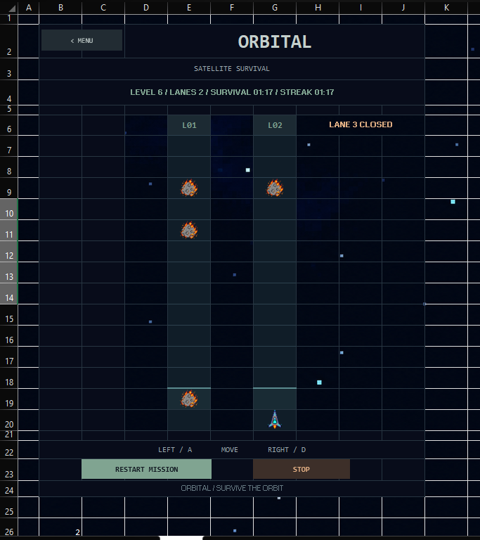
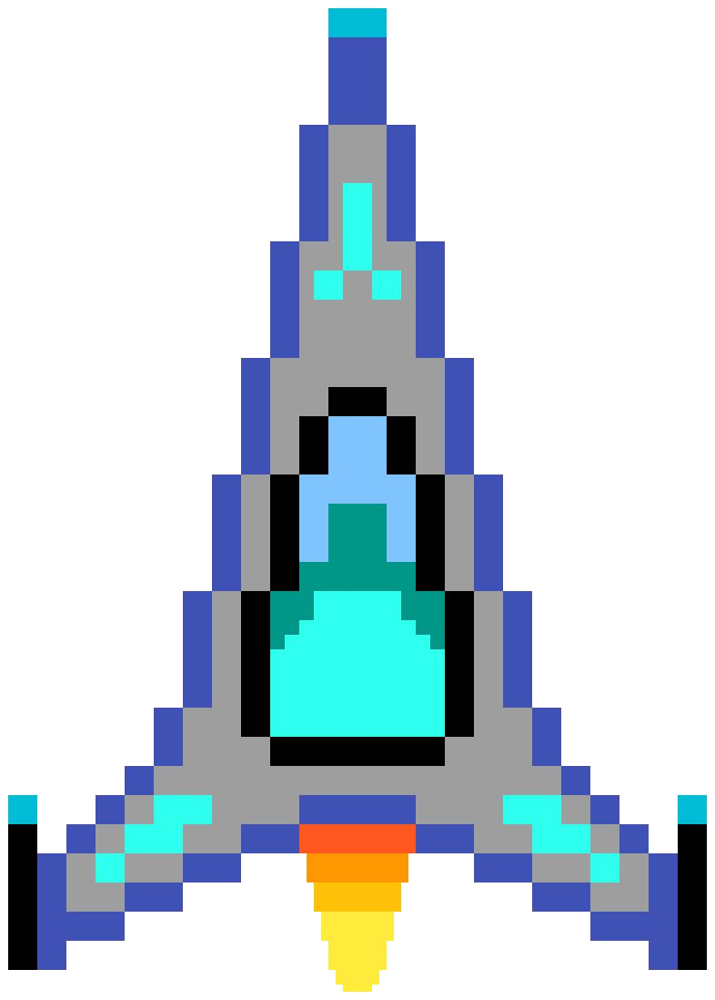
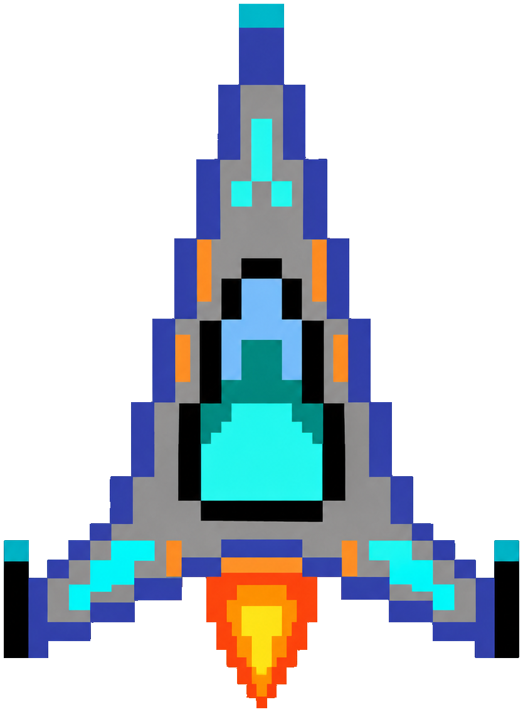
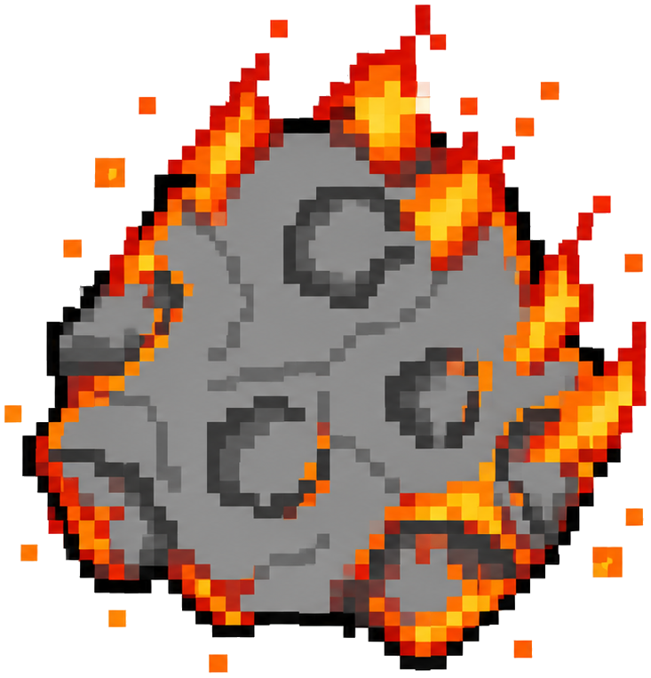

# ORBITAL

A satellite survival game made in Excel VBA. Project inspired for Wrong by Hack Club ! 

## TO PLAY ORBITAL - 
click on this [link](https://1drv.ms/x/c/659bf10470ee1146/IQBY8v-Y3jKrTZdMYFQl5f8oAU_c7hnoLzihQeygqLiB7N0?e=hHhQgD) and then download the spreadsheet and click on Launch Game on sheet 1 or just go to sheet 2 and press Start.

## About

ORBITAL is a small game built entirely in Microsoft Excel using VBA. Dodge space debris, switch lanes and survive as long as you can.

## Controls

- A / ← — Move left
- D / → — Move right
- STOP / RESUME — Pause and continue
- RESTART MISSION — Restart
- MENU — Return to the menu

## Rockets

**Rocket 1** - for level 1-5 

**Rocket 2** - for level 6 to the end 

## Space Debris

Regular debris.

Flaming debris, introduced at level 6. for pros to stay pro 

## Background

## Running the game

1. Download `ORBITAL.xlsm`.
2. Open it in desktop Microsoft Excel.
3. Enable macros if prompted.
4. Open the **About Orbital** sheet and click **LAUNCH ORBITAL**.

## Built with

- Microsoft Excel - Engine ig 
- VBA 
- Doodle (my personal art space) - to design Rockets and Debris 
  please try [Doodle](https://yousufprojs-exe.github.io/Doodle/) too! 
- Custom game sprites

## AI Usage ? yes I used but -> 
as ofc VBM was veryyy new for me! 
This project does use AI, but only for coding help when I got stuck, mainly with bugs and figuring out why certain things weren't working as expected. I used it to help debug and get past issues I couldn't solve on my own.

No AI was used to create the assets or decide the creative direction of ORBITAL. The visuals, game design, and overall idea were my own. AI was basically just there when the code decided to ruin my days 😭

## Devlog

See [DEVLOG.md](DEVLOG.md) for the development log, I wrote it manually.
